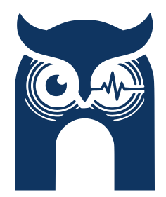

# Sally: Wearable Device

<table border="0">
<tr>
<td width="50%" align="center">

</td>
<td width="50%" align="center">

</td>
</tr>
</table>

Sally’s mobile application is designed to provide users with daily clarity through conversation transcription, summarization, and health analytics.

## 📋Project Structure

The project follows a modular structure to ensure reusability and maintainability:

### `lib/`

The core source code of the application.
- `main.dart`: The entry point of the app. Handles theme configuration and top-level navigation (Home, Device, Chat, Profile).
- `splash_screen.dart`: The initial loading screen with branding.
- `login_page.dart`: User authentication interface with dummy credential support.
- `device_page.dart`: Bluetooth device management, including pairing (mock) and removal.
- `chat_page.dart`: Displays conversation transcripts with syncing capabilities.
- `summary_page.dart`: Detailed report view for specific transcripts, featuring analytics and conversation insights.
- `profile_page.dart`: User profile management with editable fields.

### `lib/widgets/`

Reusable UI components used throughout the app:
- `sally_logo.dart`: Centralized branding icon component.
- `sally_button.dart`: Standardized primary button with Sally branding.
- `sally_nav_bar.dart`: Animated bottom navigation controller.
- `nav_item.dart`: Individual interactive elements for the navigation bar.
- `home_card.dart`: Styled containers for home screen metrics.

### `assets/`

Contains all static resources:
- `images/`: SVG and PNG icons for devices, navigation, and branding.

## ✨Features

- **Seamless Navigation**: Animated bottom navbar for quick access to core features.
- **Device Pairing**: Mock Bluetooth detection and management.
- **Smart Summaries**: Automated “Summarize” functionality for conversation transcripts.
- **Analytics**: Visualization of fatigue levels, filler word counts, and active talk time.
- **Personalized Profile**: Editable user information synchronized with local state.

## 🏗️ Getting Started

1. **Clone the repo**: `git clone <repository-url>`
2. **Install dependencies**: `flutter pub get`
3. **Run the app**: `flutter run`

For testing the login, use:
- **Username**: `admin`
- **Password**: `password`

## 👥 Project Team

- **Sugiarto Wibowo** ([sw183@rice.edu](mailto:sw183@rice.edu))* — *Lead Developer*
- **Jeeven Balasubramaniam** ([jb310@rice.edu](mailto:jb310@rice.edu))** — *Collaborator*

### 🎓 Supervision

- **Nakul Garg** ([ng83@rice.edu](mailto:ng83@rice.edu))* — *Project Supervisor*

**Affiliation:** *Rice University, Houston, Texas, USA*

> <small>* Electrical and Computer Engineering Department</small>
> 
> 
> <small>** Data Science Department</small>
>